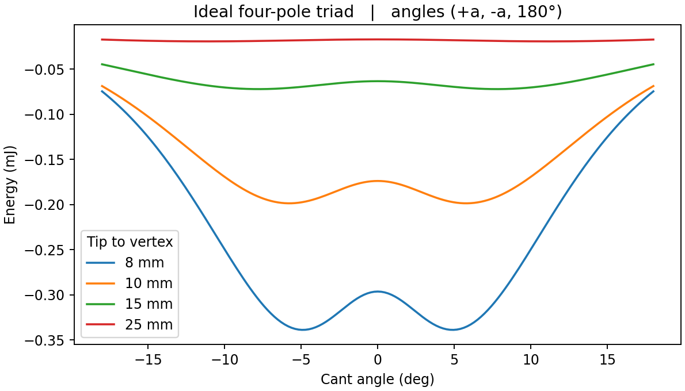

# 巨大人工スピンアイスの小型試作

磁石を両端に持つ棒を3本、頂点に向けて並べる。3本の同じ極を近づけて放すと、どの棒が向きを変えるか。3本すべての対が同時に反対極を向くことはできない。まず「2本が内、1本が外」、またはその逆に落ち着くかを目で追う。15本に広げると、1本の反転が隣り合う二つの頂点を同時に変える様子を観察できる。

**最初に作るのは、270 mm角の調整板と、同じ部品を使う3本のローター。** まず1本で摩擦と重心を測り、3本で磁石の効果が見える解放角を選ぶ。基本案は2.4 × 1.2 m、168本。量産判断に必要な小型試作の実測はこれから行う。

| 手元で使うもの | 内容 |
|---|---|
| [試作部品図・配置寸法](design/parts.md) | 1本分の部品数、ケース断面、横軸、可変間隔、15本板の原点 |
| [測定手順](experiments/protocol.md) | 単体 → 3本 → 15本。記入用の[試行台帳](experiments/runs.csv)と[角度表](experiments/angles.csv) |
| [文献比較](literature.md) | 保存資料D1・D2、カゴメ実機R1、2磁石の正方格子実機R2 |
| [購入数量と試算](budget.md) | 初回支出、追加購入、数量別価格・送料・在庫の確認状況 |
| [元の引き継ぎ書](artificial_spin_ice_codex_handoff.md) | 基本案、旧価格基準、展示全体の計画 |

## 計算から選んだ条件

**理想計算。** SI単位で磁石の外側極面間 L=0.100 m、各円柱長・径とも0.005 m、仮の一様磁化 M=10⁶ A/m。各磁石の負極から正極へ向かう方向を S→N とし、左右の磁石を同じ向きに固定する。極の位置は軸上 −50, −45, +45, +50 mm、電荷符号は −,+,−,+。q=Mπd²/4、ローター全体の磁気モーメントは 2qt。面内基準 e に対して n=e cosθ+z sinθ、正の横軸は e×z。3本計算の e は頂点向き、15本は座標表の from→to。無外場、重力・摩擦なしで異なるローターの全極対を足す。

- Δ=10 mmで平面all-inと2-in/1-outの差は **0.69501 mJ**。3角度を独立に最小化すると **(+5.773°, −5.773°, 180°)**、最小曲率は正の0.000623 J/rad²。これは一つの局所安定解。等面積に分けた円形極面で対称断面を再計算すると5.948°、平面間エネルギー差0.67773 mJ（点極比−2.5%）。この比較でも実物の磁化は未校正。[付録再現](results/reference.txt)・[極面分割の収束](results/faces.csv)
- Δを8、10、15、25 mmとすると、この枝の傾きは4.89°、5.77°、7.77°、11.17°。間隔を広げると局所最小の曲率も下がる。10 mmを基本、25 mmを弱結合対照とする。L、磁石長、径も一つずつ変えて感度を確認した。[間隔掃引](results/triads.csv)・[寸法掃引](results/dimensions.csv)
- **安定角と始動条件は別々に測る。** Δ=10 mmで (85°,90°,95°) から解放すると、初期磁気トルクは約 (−0.20,0,+0.20) µN m。同じ3本を近平面の (5°,0°,0°) に置くと (+1042,−448,−448) µN m。直立から始動しないときも、近平面で相互作用を試せる。トルクはいずれも仮定した M の二乗に比例し、実機の保持力・摩擦を要測定。[解放角ごとのトルク](results/release.csv)
- 15辺・13頂点の静的最小化では、鉛直近傍からの5個の初期値のうち4個で内部4頂点すべてが氷則、残る1個では2頂点が氷則、2頂点が未判定だった。全解でヘッセ行列の最小固有値は正。BFGSの初期値依存を示す結果であり、実機の緩和確率・時間は未評価。[格子](results/patch.png)・[初期seed別の全角度](results/patch_minima.csv)



## 再現

Python 3.10.8で実行。SpinIceディレクトリで次を実行する。計算パラメータは付録再現コード先頭と各掃引ループに明記した。

```sh
python3 -m venv .venv
. .venv/bin/activate
python -m pip install -r requirements.txt
python physics/reproduce_three_rotor.py > results/reference.txt
python physics/prototype.py
python physics/sensitivity.py
```

prototype.py は全反転対称性、解析トルクと中心差分の一致、原点となる3本のエネルギー、辺の共有と接続行列、独立角での停留性を検査する。15本の初期角は種1〜5の正規乱数（90°中心、標準偏差3°）。極面比較は2×8、3×12、4×16の等面積セルを使う。

## 未解決点と必要データ

| 優先度 | 判断したいこと | 次の測定と採用基準 |
|---|---|---|
| 最優先 | 解放時に磁気で動き出すか | 単体の正逆の始動閾値、重心偏心、2本の角度別トルクを測り、強・弱条件の動画で3本の遷移を確認 |
| 最優先 | 回転域で止まる原因 | キャップと蓋・支柱・隣接端部の全周最小隙間、軸遊び、磁石のずれ、停止方位を個体別に記録 |
| 高 | 15本で局所規則を読み取れるか | 同じ初期化で10回以上ずつ、内部4頂点の氷則・欠陥・未判定を集計。解放時刻と初期角を強弱で照合 |
| 高 | 168本を10万円に収められるか | 造形重量・失敗率、使用可能なプリンタ、板材の受取先と送料を確定。更新額を予備費込みで再計算 |

**実測　0試行。** CAD寸法は初回の加工候補。支点の摩耗、長期運用、パネル剛性、168本での集団応答は未検証。
