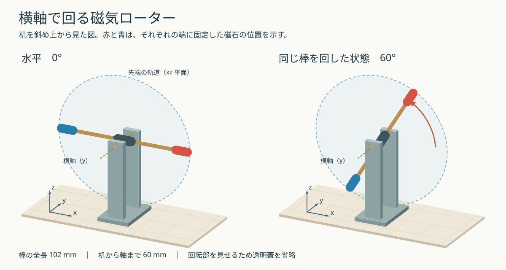
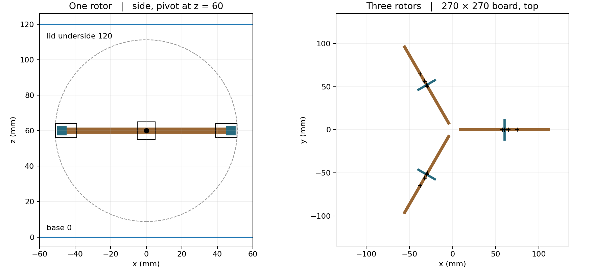
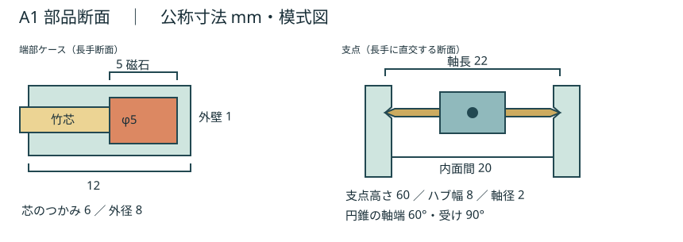
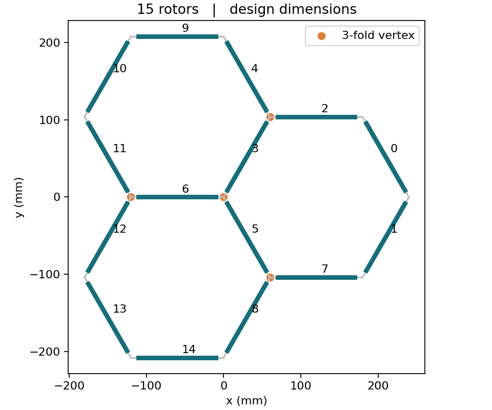

# 試作 A1 の部品図と組立寸法

**設計仮定。** 基準寸法は mm。機械長102、磁石外極面間100。磁石と同じ質量のダミーで先に組み、1周手回ししてから磁石を封入する。全数の穴加工は1組の測定後に決める。

| 部品 | 1本分（3本分） | 試作寸法・加工 |
|---|---:|---|
| 端部ケース | 2（6） | 外径8、長さ12。外端から内へ1の閉止壁、深さ5の磁石室、残り6で芯をつかむ。長手方向に二分した殻を接合し、芯側から外端側へ薄い非磁性スリーブを被せて固定。完成外径8を超える分は実測に加える。φ5.2・5.3・5.4の穴試験片で公差±0.1の磁石との嵌合を選ぶ |
| 小型磁石 | 2（6） | 円柱φ5×5、軸方向着磁。中心から±47.5に磁石中心を置く。片端から両方ともSNの順。封入前にコンパスで外端極を記入 |
| 竹芯 | 2（6） | φ3×43を開始値。中心から2〜45に左右別々に挿入。外端を磁石内面に合わせ、内端間の4を横軸に空ける |
| ハブ・軸 | 各1（3） | ハブ長手12、幅8、高さ10。両端から深さ4の芯穴。中央に直交するφ2の軸を固定。真鍮φ2×22、両先端60°の円錐、バリを研磨。回転側は軸とハブを一体化 |
| 軸受・支柱 | 各2（6） | 支柱はローター長手に直交する両側へ。柱厚4、内面間20、受けは90°円錐、深さ約1。片側を横へずらし総軸遊び0.1〜0.3を目安に調整。交換式PLA受けとPOM受けを同じ高さで比較 |
| 台座・蓋 | 台座1（3）、共通蓋1 | 台座幅36（横軸方向）×長手24、底厚3。軸中心は板上60。支柱と回転体の側面が最も近い箇所で手回し確認。透明蓋下面120、3本用板270角。1本試験でも同じ板を使用可 |

断面寸法の基準を下図に示す。寸法線は公称値。A面を各磁石室の閉止壁の内側に取る。

半径の上限は端部外角で √(51²+4²) = 51.16。板と蓋までの静的余裕は各8.84、厚3の台座直上は5.84。蓋のたわみ、芯の反り、シム、スリーブを含む実機で全周の最小隙間を測る。磁石はケースで捕捉し、引抜き・繰返し回転でずれた個体は交換する。

**3本の位置決め。** 板中心を原点、ローターA/B/Cの方位を0°/120°/240°とする。台座中心を半径 r=50+Δ に合わせ、横軸を半径線に直角にする。板に r=58,60,65,75 の中心線を引き、台座の両足を非磁性クランプで固定。Δ=10で中心は (60,0), (−30,51.962), (−30,−51.962)。最短の外極面中心間距離は √3Δ。実際のキャップ間隔はこれより小さいため、隣同士も全周確認する。

**準備・解放。** 各支柱の外側に着脱式の扇形角度目盛を置く。非磁性の薄いフォークでハブ脇の芯を設定角に支え、蓋を閉じてから3本の糸を共通の取手で引き、フォークを各横軸方向に抜く。カバーを閉じた状態で行程と糸の退避をダミーで確認。最初と最後の離脱フレーム差、解放直後の角度を動画で記録する。

**15本の位置決め。** 3個の正六角形が中央頂点で接するパッチを使う。500角の板の左下から (220,250) を計算原点に取る。CSVの中心座標は m 表記なので1000倍して平行移動する。横軸の方向は (ey,−ex)、軸高さ60。4個の三配位頂点と9個の二配位端部を含む。・[全15本の座標](../results/rotors.csv)

**造形量の初回見積。** 台座36×24×3と、高さ60・厚4・長手幅12の柱2本を中実直方体で近似すると8.35 cm³。PLA密度を1.24 g/cm³と仮定すると約10.4 g。ケース2個・ハブの外接体積を足して約13 g/組が出発点。リブ・受け調整・固定耳・治具・失敗分は別。1組をスライス・秤量し、既存計画の15 g/組、4 kg購入枠に戻して判定する。
