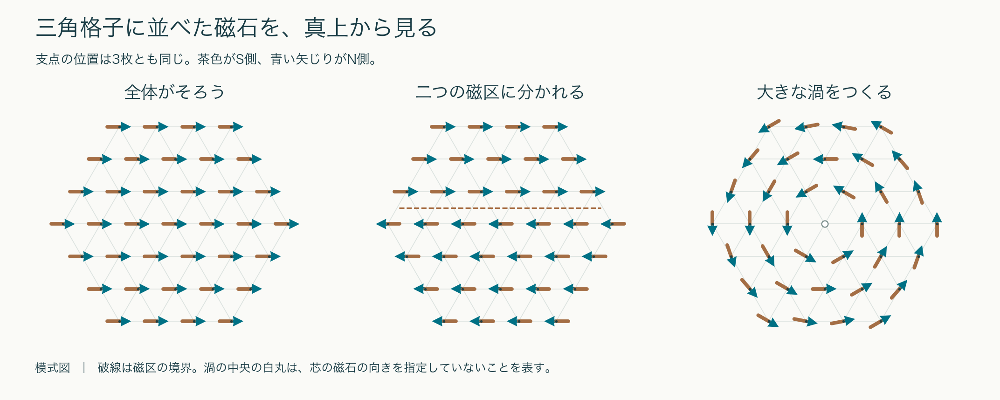

# 三角格子の面内ローターで磁区と渦を見る

机の上に方位磁針のような磁石を並べ、N極に色を付けて真上から見る。近くの数本が同じ方向を向いたとき、遠くの磁石までそろうのか。向きの異なる領域に分かれるのか。それとも外周に沿って向きが一周するのか。前任者の面内回転機構を利用する展示案である。

**図の読み方。** 青がN極。中央の図では、近所の磁石が同じ方向を向く領域が二つあり、破線付近で向きが変わる。右図では、支点の位置は固定したまま、N極の向きが中心を巡って一周する。ここでいう「渦」は停止後の配列で、一枚の写真から読める。図は配置の模式例である。

## この機構で何を確かめるか

前任者の装置について分かっているのは、多数の面内回転磁石の支点が三角格子状に並んでいたこと。意図していた模様、間隔、支点摩擦、当時の停止状態は未確認。鉛直軸が正しく立っていれば、回転しても重心の高さが変わらず、面外回転案で問題になる重力の偏りを抑えられる。始動摩擦は実機で測る。

孤立した正三角形では、各磁石が二つの隣に対し同時に最適な一直線の配置を取れず、点双極子模型では三本の向きが一周する渦が候補になる。格子に広げると内部の一本が六つの三角形に共有される。小さな渦の単純な繰り返しを仮定せず、磁区の大きさ、境界、試料全体の巻き方向を調べる。有限の三角格子の理論では、試料の縦横比が一様状態・磁壁・渦のエネルギー競争に効く。今回の棒の有限長、地磁気、摩擦、準備履歴を含めた結果は未測定。[Politi・Pini・Stamps の三角格子模型](https://doi.org/10.1103/PhysRevB.73.020405)

集団固有振動、渦の巻き数、二層をねじったときの再配列、ランダム駆動による秩序の変化については、[面内ローターで測る集団現象](collective_physics.md)に先行研究と測定案を整理した。

## 最初の試作

| 段階 | 準備と操作 | 見どころ・対照 |
|---|---|---|
| 2本で動作確認 | 非対称な角度から放し、距離を変える | 何も動かない場合は、まず隣の磁石で始動できる間隔を探す。どこでも同じ方角を向く場合は、台を90°回して部屋に対する向きを比較する |
| 6本で輪を作る | 正六角形の頂点に置き、全てのN極を同じ周回方向の接線に合わせる。1本を少しずらして放す | ずらした棒が戻るか、そこから輪がほどけるか。時計回り・反時計回りと、隣を外した単体を同じ初期角で比べる |
| 19本で渦の伝わり方を見る | 中心1＋内周6＋外周12。外周だけを接線方向に仮固定し、内周はばらばらから放す | 外周の巻き方向を反転すると内周6本も反転するか。その後、外周の治具を外して保持を観察する |
| 自由な格子で磁区を探す | 全周を自由にし、同じ本数と間隔で細長い形と六角形に近い形を作る。初期角を変えて反復する | 一様な配列、複数の磁区、渦のどれが現れるか。近所だけそろう状態も記録する |

各試行で、格子間隔、初期角、治具を外した時刻、停止後の俯瞰写真を残す。N極を矢印で重ね、内周と外周を別々に読む。巻きを数値で比べるなら、各磁石のS→N単位ベクトルと、その位置での反時計回りの単位接線の内積を輪ごとに平均する。全て反時計回りなら +1、時計回りなら −1。中心は接線が定まらないため除く。平均が0付近のときは、一様状態と複数磁区を写真で区別する。

## 中心電流を使う選択肢

電流を流して巻き方向を選び、切った後で渦が残るかを観察する。電流で作った渦の保持と、外場を加えずにばらばらの初期状態から渦が生じる過程は、別の試行として記録する。[磁場・トルクの見積もりと確認手順](central_current.md)

## 氷則を見たい場合

カゴメ氷則は、蜂の巣の辺の矢印が三配位頂点で「2本が内向き・1本が外向き」またはその逆になる規則。自由回転する三角格子の渦には、各磁石をどの辺の内向き・外向きと判定するかが定まっていない。面内機構で氷則を目指す場合は、蜂の巣の各辺にローターを割り当て、辺に沿う二方向を弱く好む機構と、隣の磁石で反転できる条件を別途検証する。[面内磁化を持つ人工カゴメ格子での氷則の観察](https://doi.org/10.1103/PhysRevB.77.094418)・[面外回転を使う既存のカゴメ展示案](../README.md)
