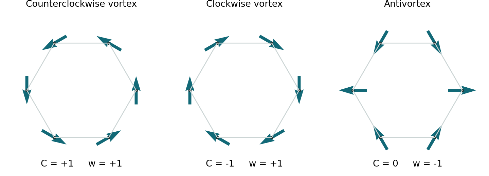

# 面内ローターで測る集団現象

2026-11-19 調査。前任者の三角格子に、方位角を自由に選ぶ磁石が載る場合を考える。実機の磁気モーメント、慣性、摩擦、格子間隔は未測定。以下の周波数比は理想模型からの予測、写真は角度配置の模式図である。

## 1．2本の磁石が持つ二つの固有振動

2本の中心を結ぶ線を x 軸に取り、両方のN極が +x を向いた状態から少しだけ動かす。同じ側へ傾けて放すと同相モード、逆の側へ傾けて放すと逆相モードを選択できる。隣の磁石も動けることが復元力を変え、同じ2本から異なる音程に相当する二つの周波数が生じる。

**今回の導出。** 同一の点双極子、同じ慣性モーメント I、中心間隔 d、外場ゼロとする。両方の角度を共通の +x 軸から反時計回りに測る。D = μ₀μ²/(4πd³) とすると、相互作用エネルギーは
     
    U/D = −2 cosθ₁ cosθ₂ + sinθ₁ sinθ₂
        ≃ −2 + θ₁² + θ₂² + θ₁θ₂

角度に関する二階微分行列の対角成分は 2D、非対角成分は D。同相の角周波数は √(3D/I)、逆相は √(D/I)。理想的には周波数比 √3、個々の周波数は d の −3/2 乗に比例する。既知の一様磁場 B を +x にかけると、復元係数にそれぞれ μB が加わる。正味の磁場が強いほど比は1に近づくので、地磁気や準備用磁場が効く装置で比がずれても不思議ではない。

**実験案。** 各棒のN側に印を付ける。中心間隔と向きを固定して同相・逆相を別々に小角から解放し、動画から (θ₁+θ₂)/2 と (θ₁−θ₂)/2 を描く。同じ周期が複数回読めるか確認し、孤立1本・異なる間隔も測る。摩擦で一振りで止まるなら、周期を読む実験は難しい。棒の長さが間隔に近い場合には点双極子近似そのものが比較対象になる。実際のミリメートル級方位磁針の配列でも磁石形状による高次の効果を検討した研究がある。[方位磁針配列の実験と多極子模型](https://www.sciencedirect.com/science/article/pii/S2666032620300284)

19本へ戻したら、安定した初期配置の1本に小さなずれを与え、時系列から複数の棒に共通する振動数と、その周波数での相対位相を測る。有限パッチでの測定対象は集団固有モード。比較文献では正方格子方位磁針の秩序配置を実演し、双極子結晶の分散関係を計算している。今回の三角格子で分散を測定した先例とは区別する。[Nishimatsuら、American Journal of Physics](https://www.nist.gov/publications/ferroics-magnetic-compass-lattice-and-optical-phonon-dispersions-dipolar-crystals)

## 2．循環と位相欠陥を区別する

渦の中心を囲む閉路を、一貫して反時計回りにたどる。C は各磁石の単位ベクトルと反時計回りの単位接線との内積の平均。w は隣り合う矢印の符号付き最小角度差を一周分足し、360°で割った値。図の左から (C,w) = (+1,+1), (−1,+1), (0,−1)。反渦の模式例は、観測位置の方位を φ としてN極の角が −φ となる配置。

**物理的な問い。** 時計回りを反時計回りに変えると、渦を消したことになるか。六角形の全ての矢印を一様に180°回せば、一方の接線配置から他方へ移れる。その途中で循環 C は0を通るが、隣同士の角度差が保たれるので w はずっと +1。この操作の途中にエネルギー障壁があるかは別の問い。薄膜磁性体でも循環と巻き数を区別している。[磁気渦・反渦の一次研究、Fig. 1](https://www.osti.gov/servlets/purl/1843189)

**三角格子での観測案。** 19本の各磁石にIDを付けて全角度を撮影し、小三角形の周と、それらを囲む大きな閉路の両方で w を求める。隣接三角形で共有辺を逆向きにたどるため、角度差が一意に決まれば、小三角形の w の総和は外周の w と一致する。欠陥がどこにあったか、境界から出たか、内部で正負が対になって消えたかを時系列で照合できる。厳密に180°の辺では最小角度差の符号が一意でなく、測角誤差内で180°に近い辺に接する面は未判定にする。図は識別の手本で、自由解放後に反渦が安定するかは未確認。離散的な有限格子では局所的な巻き数変化が可能で、渦の保持やBKT転移を巻き数の測定だけから結論できない。

## 3．二層化して幾何で集団配置を切り替える

各層6本の面内回転磁石を、同軸の二枚の正六角形の板に載せる。層間距離を固定し、ローターは自由にしたまま片方の板だけを回す。個々の磁石に外場をかけなくても、最近接の相手とその方位が変わり、集団で選ぶ向きが変わる。Melladoらは六角形二層の実験と、多角形ごとの数値最小化を比較した。ねじれ角に伴う渦状から放射状への再配列が展示に直結する。異なる多角形の全ての分岐が実機で確認されたわけではない。[出版論文](https://doi.org/10.1088/1361-648x/ae6389)・[著者公開稿、Fig. 1–4](https://arxiv.org/html/2601.22325v1)

**測定案。** ねじれ角を往復させ、各層の接線成分と半径方向成分を角度に対して描く。同じ板角で再配列の経路が違うか、停止後も違いが残るかを見る。単層、二層を遠ざけた条件、回す速さを変えた条件で再測定して、摩擦による遅れと層間結合の影響を見分ける。上下の磁石が重なっても見分けられる色と視点が必要。

## 4．揺らぎを加えて秩序・無秩序を調べる

22×22本の正方格子の方位磁針にランダム外場を加え、秩序の消失を実験とMonte Carloの双方で調べた先例がある。日常サイズの磁石に、制御した揺らぎを外から与えた点が重要である。[Thermodynamic study of a lattice of compass needles in dipolar interaction](https://doi.org/10.1103/PhysRevB.58.9238)

三角格子で試すなら、駆動振幅を変え、角度相関を格子距離別に測る。全ての磁石に同じ磁場を加えると、単に全体が追従して相関が高くなることもある。単体の応答、遠く離した配列、駆動停止後の緩和を対照にする。19本でも「駆動とともに相関がどう変わるか」は問える。平衡温度や熱力学的な転移を論じるには、定常分布の検証とサイズ依存性が別途要る。

## 試作の順序

現行部品で最初に試すのは2本の同相・逆相測定。振動が強く減衰する場合には、静止写真で測れる循環と巻き数の比較を先行する。来場者の一操作で集団の向きを切り替える展示を目指す場合は、単層の追加測定を経て六角形二層を試す。
