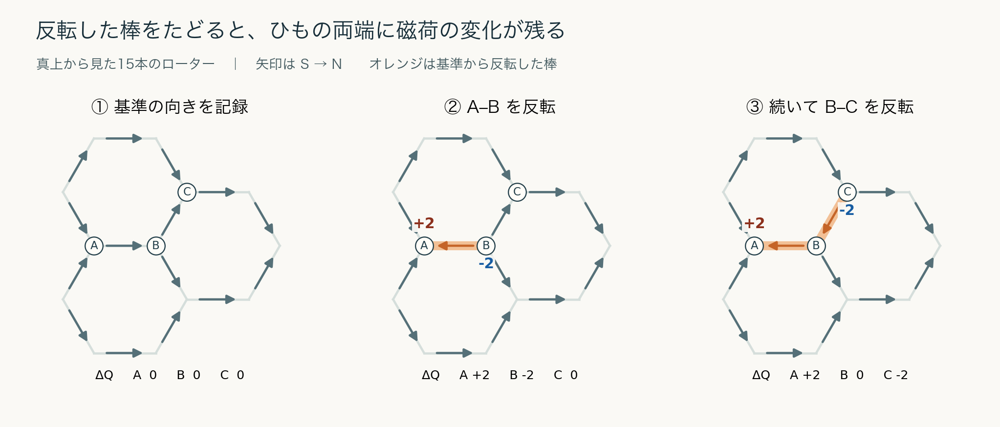

# 面外回転カゴメ氷の物理ノート ― 氷則の先にある創発と励起

**氷則を満たした格子で、まだ何が変われるだろうか。** 例えば、ある棒を1本反転すると、両端の頂点はどちらも「2対1」のまま、その頂点の磁荷だけが入れ替わる。逆に、六角形を一周する6本を全部反転すると、磁石の模様は変わるのに、どの頂点の磁荷も変わらない。この二つを実物の棒とその俯瞰写真で見せるのが、今回の展示で考えている「氷則の先」である。

2026-11-19 時点。15本試作の数値は設計寸法での理想計算。実機の測定はこれから行う。[面外ローターの部品図](../design/parts.md)・[試作と測定の手順](../experiments/protocol.md)

**100本を同時に解放したときの動き。** 斜め横から見たローターと、上から見た頂点の氷則判定を同期させた。[緩和の動画（MP4）](relaxation/relaxation-100.mp4)・[計算条件・元データ](relaxation/README.md)

**氷則を満たした後に1本だけ返す実験。** 一定の面内磁場で負の欠陥が隣へ1辺移る様子を、無外場の対照と比較した。[欠陥伝播の動画（MP4）](defect_propagation/defect-hop.mp4)・[磁荷の検証と元データ](defect_propagation/README.md)

**氷則を保ったまま、揺れを送る実験。** 1本だけを軽く弾くと、磁荷が等しい2つの配置でも36 cm先の棒に異なる波形が届いた。途中の六角形の向きと受信波形を並べて見られる。[振動伝播の比較動画（MP4）](vibrations/pulse.mp4)・[計算条件と元データ](vibrations/README.md)

## 1．Y字の頂点から、格子全体の氷則へ

ハニカムの各辺に磁石を1本置く。棒は辺の中央にある水平な軸のまわりを縦に回り、ほぼ水平に寝た状態では、その辺に沿う二方向を取れる。矢印を S → N とすると、ある頂点の近くにN極があれば「入る」、S極があれば「出る」。その差を無次元の頂点磁荷 $Q=N_{\rm in}-N_{\rm out}$ と呼ぶ。

Y字に集まる3個の端では、3組のペアすべてを異極にできない。近くの極どうしが引き合う組を最も多く作れるのが、NNS または NSS、すなわち **$|Q|=1$ の氷則配置**である。少数極がどの棒に来るかまで数えると6通り。一方、NNN と SSS は $|Q|=3$ の**氷則違反**である。隣り合う頂点は1本の棒を共有し、その両端には逆の極が来る。そのため、各頂点が独立に六択を選ぶことはできない。

同じ極を上にそろえた直後は in/out が未確定である。完全に対称で初速度もゼロなら鉛直のまま静止し得るが、小さな傾きから棒が動き出すと、互いの磁気トルクを受けながら倒れる。Melladoらは面外回転する352本の棒磁石で、分極状態から氷則配置への緩和を観測した。今回の両端小型磁石でも同じ配置に到達するかは測定対象である。なお、独立に等確率で向きを選んでも1頂点の氷則率は $6/8=75\%$ になる。[Melladoら、Fig. 1–2](https://arxiv.org/abs/1207.2374)

## 2．何が創発するのか ― 磁荷の秩序と、残る自由度

氷則は各頂点を $Q=+1$ または $-1$ に絞るが、隣の符号までは決めない。実際、15本の静的最小化では、三配位の4頂点がすべて氷則を満たしていても、中央と隣3個の符号がすべて逆の解（seed 1、3）、すべて同じ解（seed 2）、一部だけ逆の解（seed 4）が得られた。seed 5は2頂点が未判定。これらは異なる初期値から得た局所解であり、各配置の出現確率は測っていない。[全角度を保存した計算結果](../results/patch_minima.csv)

**文献での予測。** 長距離の双極子相互作用を含む平衡模型では、磁石の配置が完全に秩序化するより先に、ハニカムの二つの副格子で磁荷の正負が交互に並ぶ段階（Ice II）がある。磁石は辺にしか置いていないのに、この段階の秩序を記述するのは頂点の磁荷である。[Chern・Mellado・Tchernyshyov、カゴメ氷の二段階の秩序化](https://arxiv.org/abs/0906.4781)

**磁荷が決まっても残る自由度。** 矢印を一周たどれる六角形で、輪の6本を全部反転する。各頂点では「輪から入る1本、輪へ出る1本」が入れ替わり、外へ伸びる3本目はそのままなので、全頂点で $Q$ が保存される。交互磁荷の背景で各頂点の少数極に印を付けると、両端に印が付いた辺（ダイマー）が各頂点を1回ずつ覆う。ループ反転によって輪上のダイマーは交互の3辺から残りの3辺に移る。磁荷の地図と磁石の写真を並べれば、この違いが見える。人工カゴメ氷では、磁荷を担う成分と循環の成分に磁石の配置を分解し、磁気の *fragmentation* の徴候を調べた実験もある。手動のループ反転はこの自由度の実演であり、集団が自発的にどの秩序を選ぶかは別に検証する。[Canalsら、人工カゴメ氷の実験](https://doi.org/10.1038/ncomms11446)

## 3．1本を返すと、欠陥は生まれるか、どこまで動けるか

氷則を満たす二つの頂点をつなぐ棒を1本反転する。各端では、その極が**もともと多数側なら**2対1の多数派が入れ替わり、**少数側なら**3対0になる。従って、作られる氷則違反の数は、その棒が両端のうち何か所で少数側だったかに応じて、0、1、2個のいずれにもなる。一端の $Q$ が2増えると他端では2減る。境界も含む全頂点で磁荷の和が保存される。

すでに NNN の欠陥があるとき、その頂点から出る棒の反対端は必ずSである。その棒を返すと、次の頂点の**残り2個の極**で結果が決まる。

| 隣の残り2極 | 反転前の2頂点の $Q$ | 反転後 | 観察されること |
|---|---|---|---|
| N・N | $(+3,+1)$ | $(+1,+3)$ | NNN が隣へ一歩移る |
| N・S | $(+3,-1)$ | $(+1,+1)$ | 両方が氷則に戻り、違反が1個消える |
| S・S | $(+3,-3)$ | $(+1,-1)$ | NNN と SSS の対が消える |

1段目の操作だけを繰り返して欠陥を運ぶと、次の行き先は周囲の磁石の向きに制限される。行き止まりや、同じ欠陥を保ったまま外へ出られない領域もある。他の棒を先に返せば道を作り替えられる。この到達範囲の制限から、欠陥間のエネルギーが距離とともに増えるかどうかは決まらない。

## 4．Dirac string と、氷則を保つ励起

ここで**磁荷 $Q$ と、基準写真からの差 $\Delta Q$** を使い分ける。前節の氷則違反は $|Q|=3$ で数えた。Mengottiらが磁化反転の過程で追ったモノポール・反モノポールは、磁荷が交互に並ぶ飽和状態を基準とした正負の余剰磁荷に対応する。基準から反転した棒が連なると、その列が *Dirac string* になる。論文は外場を加えたナノ磁石配列で、反転列が伸びて端点が離れる様子を観測した。[Mengottiら、Fig. 1–2](https://www.nature.com/articles/nphys1794)

基準の矢印に沿う道 A → B → C を順に反転すると、途中のBでは「出」と「入」がひとつずつ反転して相殺する。両端だけに $\Delta Q=+2,-2$ が残る。図③のCは $+1\to-1$ なので、氷則を守ったまま負の端点になっている。道が閉じれば端点が消え、ループ反転になる。全頂点の $Q$ が元に戻っても、遠くの磁石との相互作用まで含めたエネルギーは変わり得る。

**15本の理想計算。** 同じ基準①から、図の順に2本を返す場合と、B–Cだけを直接返す場合を比較した。エネルギー差の基準はすべて①。判定対象は三配位の4頂点で、4番目の頂点には反転が及ばない。

| 状態 | 基準から反転した辺 | 実際の $Q$（A, B, C） | $\Delta Q$（A, B, C） | 氷則違反 | ①からのエネルギー差［µJ］ |
|---|---|---|---|---:|---:|
| 図① | なし | $(+1,-1,+1)$ | $(0,0,0)$ | 0 | 0 |
| 図② | A–B | $(+3,-3,+1)$ | $(+2,-2,0)$ | 2 | +1,384.308 |
| 図③ | A–B と B–C | $(+3,-1,-1)$ | $(+2,0,-2)$ | 1 | +689.769 |
| ①からB–Cだけ反転 | B–C | $(+1,+1,-1)$ | $(0,+2,-2)$ | 0 | +0.471 |

**②→③**では、ひもが伸びても氷則違反が一つ減り、エネルギーは約695 µJ下がる。**①から1本だけ**返す場合、A–Bでは氷則も破れて約1,384 µJ上がるが、B–Cでは全頂点で氷則を保ち、磁荷の交互配列だけが局所的に崩れて約0.47 µJ上がる。氷則違反の個数だけを数える模型なら後者のコストはゼロである。**磁荷の秩序が相互作用で選ばれれば、その秩序だけを乱す励起を、氷則の内側に作れる**というのが物理的なポイントである。[カゴメ氷で二種類の励起を区別した研究、Fig. 1](https://doi.org/10.1038/s41467-023-36760-1)

計算では磁石外極面間100 mm、端部磁石は径・長さ各5 mm、端面から頂点まで10 mm、仮定した磁化は $10^6$ A/m。15本を水平に固定し、無外場で全ローター対の4磁極相互作用を評価した。再計算するには、座標表の各辺で矢印が右向き成分を持つ方を①とし、図の A, B, C を頂点ID 9, 3, 2、A–B と B–C を辺ID 6, 3 に取る。該当辺の角度に $\pi$ を加えた前後を比較する。表は特定の有限配置の静的エネルギー差であり、途中の面外回転の障壁や、実機の励起ギャップを与えるものではない。[格子座標と辺ID](../results/rotors.csv)・[計算関数 `potential`](../physics/prototype.py)

## 5．展示で何を測れば、一段深い主張になるか

| 物理の問い | 見せ方と判断材料 |
|---|---|
| 氷則の先に、磁荷の秩序を選ぶ傾向があるか | 同じ試行を「棒の矢印」と「頂点の正負」の二枚で表示する。全頂点が氷則を満たす試行どうしで、隣接頂点の異符号率を求め、同じ境界・同じ格子で氷則だけを課した参照配置と比較する。15本には内部頂点どうしを結ぶ辺が3本あり、まず局所相関を問える |
| 同じ磁荷模様に複数の配置があるか | 磁荷を固定したループ反転の前後で、磁荷画像の一致と矢印画像の変化を重ねて示す。六角形6辺＋外向き6辺の12本に組み替えれば、輪の6頂点をすべて三配位にできる |
| 励起はいつ生まれ、どう応答するか | 俯瞰動画に $Q$ と $\Delta Q$ を重ね、鉛直付近は未判定とする。初めて2対1になった時刻と最後に安定した時刻を比べる。同じ支点で周囲の配置を変え、局所刺激で反転する閾値も比較できる |
| ひもが自力で伸びるか | 非磁性の治具で最初の1本だけ操作し、手を離した後の反転順を追う。少し揺れて戻る、1本だけ隣に伝わる、複数本が順番に反転する、を動画で区別する。低摩擦でも、次の棒が障壁を越えるだけのトルクや運動エネルギーが要る |

**展示の軸は、棒の配置が違っても磁荷の地図には共通の秩序が見え、その秩序だけを乱す操作があるか、という問いである。** 15本で手動の生成・移動や短い反転列を示す段階と、多数の試行・より広い格子で相互作用による秩序選択を検証する段階を区別する。解放実験は準備履歴と摩擦に依存し、平衡相の同定や自発的な連鎖反転は未検証である。
