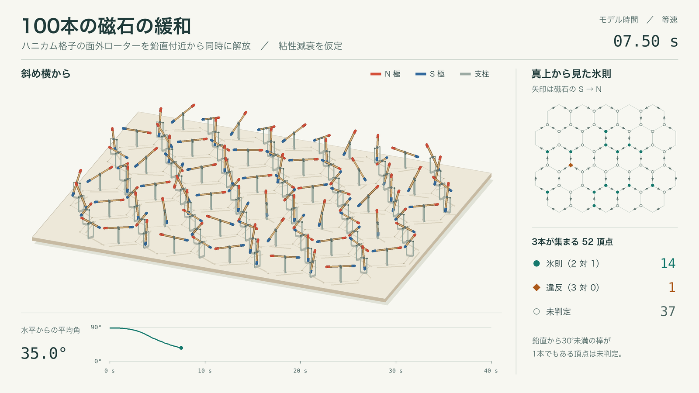

# 100本の面外ローターの緩和

[斜め横から見た動画（MP4、約27秒）](relaxation-100.mp4)。磁石を一斉に解放した後の40モデル秒を、机から仰角27°の固定視点で再生する。22モデル秒までは等速、その後は4倍速。左は赤がN極、青がS極、灰色が支柱。右は同じ時刻を真上から見た磁石の向きと頂点の判定である。

[](relaxation-100.mp4)

この初期配置では約5モデル秒で最初の頂点が氷則を満たし、7.5秒で氷則14、違反1、未判定37になった。40秒時点では **氷則34、違反2、未判定16**。未判定の16頂点には、鉛直に近いままの8本の少なくとも1本が接している。この1試行から平衡での欠陥密度や実機での到達確率は求めていない。

## 計算条件

- 格子は六角形を5、6、5、6、5個の順に並べた開放境界。共有辺を数え直すと棒は100本、3本の棒が集まる頂点は52個になる。磁石の外側極面間は100 mm、格子の辺は120 mm、回転軸の高さは60 mm。各棒は格子の辺を含む鉛直面内を回転する。[部品図](../../design/parts.md)
- 各棒の両端に直径5 mm、長さ5 mm、磁化 $M=10^6\,\mathrm{A/m}$ の磁石を置く。異なる棒の全4,950組について各16個の磁極対を足し、既存の4磁極模型から角度ごとのエネルギー $U$ と磁気トルクを求めた。[磁気エネルギーとその勾配](../../physics/prototype.py)
- 運動方程式は $I\ddot\theta_i=-\partial U/\partial\theta_i-I\gamma\dot\theta_i$。全棒で $I=5.0\times10^{-6}\,\mathrm{kg\,m^2}$、$\gamma=1.6\,\mathrm{s^{-1}}$ と仮定した。重心は軸上、外場と静止摩擦はゼロとした。実機で何秒かかるか、軸受の摩擦に勝って動き出すかは未校正である。
- 最初は全てN極を上向きとし、各棒に独立な正規分布の傾き（標準偏差3°、乱数シード7）を与えた。角速度は全てゼロ。一度解放した後は外から棒を操作せず、100個の角度を同時に時間積分した。
- 右図では、棒の面内射影が長さの半分に満たない場合、その棒に触れる頂点を未判定とする。残る三配位頂点で、入る棒と出る棒が2対1なら氷則、3対0なら違反とした。境界の二配位頂点は集計から外した。下の曲線は100本の棒と水平面とのなす鋭角（0〜90°）の平均である。

時間積分には適応刻みの DOP853 を用いた。相対許容誤差を $2\times10^{-12}$ から $2\times10^{-13}$ に絞って再計算すると、1,201時刻のうち17.70秒の1頂点だけが氷則と未判定の境をまたいだ。個々の棒の角度差は途中で最大5.14°、40秒時点で最大0.002°未満。動画は細かい方の計算を使った。全フレームでの「磁気エネルギー＋運動エネルギー＋散逸熱」と初期エネルギーの差は、最終散逸熱の $1.1\times10^{-13}$ 以下である。

## 減衰を変えると全52頂点が氷則に入るか

**同じ初期角度で、減衰率を $1.6$ から $0.2\,\mathrm{s^{-1}}$ に下げると全52頂点が氷則に入った。** 慣性モーメント、磁石、格子、判定基準は共通。動画の時計で31.0秒に初めて全頂点がそろい、揺り戻した後、36.1秒から40秒まで全て氷則だった。40秒時点で鉛直に近い棒が1本残るが、その両端はどちらも集計対象の外にある二配位頂点である。[弱い減衰の動画](weak-damping/relaxation-100.mp4)・[その軌道データ](weak-damping/trajectory.npz)

各セルの数は **氷則 ／ 違反 ／ 未判定**。初期角の乱数シードは全行7。元の条件は保存済みの40秒の角度・角速度から120秒まで継続した。その他は解放時から同じ4磁極のエネルギーとトルクを積分した（DOP853、相対許容誤差 $2\times10^{-12}$）。

| 粘性減衰率 $\gamma$［s⁻¹］ | 40モデル秒 | 120モデル秒 |
|---:|---:|---:|
| 3.2 | 30 ／ 0 ／ 22 | 30 ／ 0 ／ 22 |
| 1.6（元の動画） | 34 ／ 2 ／ 16 | 36 ／ 2 ／ 14 |
| 0.8 | 45 ／ 1 ／ 6 | 45 ／ 1 ／ 6 |
| 0.4 | 49 ／ 1 ／ 2 | 49 ／ 1 ／ 2 |
| 0.2 | 52 ／ 0 ／ 0 | 52 ／ 0 ／ 0 |
| 0.1 | 40 ／ 0 ／ 12 | 52 ／ 0 ／ 0 |

40秒の動画で、いったん向きを判定できた棒がその後逆向きまで振れた本数は、元の減衰では100本中11本、弱い減衰では90本だった。ここでは面内射影が $+0.5$ 以上から $-0.5$ 以下（またはその逆）に達したときに1回と数えた。減衰を弱めると最初に倒れた方向から向きを選び直す棒が増える。一方、$\gamma=0.1$ の例では全頂点が氷則に入るまでの時間が長くなった。

**初期角度と数値精度への感度。** $\gamma=0.2$ で初期の傾きの標準偏差を3°に保ち、シードを1、2、3、7にすると、120秒の氷則数は順に50、52、52、52だった。シード1では違反1、未判定1が残った。シード7で許容誤差をさらに10分の1に絞ると、$\gamma=0.2$ では52頂点すべてが氷則という結果が再現したが、120秒の棒の面内射影の符号は100本中48本で変わった。$\gamma=0.4$ では100秒時点の氷則数も49と52に分かれた。個々の棒の反転順や、全頂点がそろう減衰値の境界はこの比較からは特定できない。

元の条件では120秒の最大角速度は $2\times10^{-13}\,\mathrm{rad/s}$ 未満で、磁気エネルギーの角度に関するヘッセ行列の最小固有値は正（$3.66\times10^{-6}\,\mathrm{J/rad^2}$）だった。氷則を満たさない頂点がある配置も、この磁気模型の局所安定状態になれる。初速度ゼロ・全棒で共通の $I$ と $\gamma$ の場合、$s=t\sqrt{I_0/I}$ と時間を取り直すと、軌道を決める減衰率は $\gamma\sqrt{I/I_0}$ となる。ここでは $I_0=5\times10^{-6}\,\mathrm{kg\,m^2}$ に固定してその効果を比較した。

## 元データと再生視点

[trajectory.npz](trajectory.npz) に1/30モデル秒ごとの角度、角速度、頂点磁荷、位置、エネルギー、散逸熱、計算条件を収録した。角度はラジアンで、0が格子の辺の基準向き、$\pi/2$ がN極の鉛直上向き。公開されている同種の実験でも、磁極間の相互作用と軸の粘性減衰から面外緩和が調べられている。[Mellado ら、Phys. Rev. Lett. 109, 257203](https://arxiv.org/abs/1207.2374)

リポジトリのルートで次を実行する。保存済みの軌道から動画を描き直す場合は最後の行だけでよい。システムに FFmpeg がある場合は、描画にそちらを使う。

```sh
python3 -m pip install -r SpinIce/requirements.txt Pillow imageio-ffmpeg
python3 SpinIce/out_of_plane/relaxation/simulate.py
python3 SpinIce/out_of_plane/relaxation/render.py
```

[計算コード](simulate.py)・[描画コード](render.py)。例えば `render.py --elevation 18 --azimuth -55 --output low-view.mp4` で視点を低くできる。

減衰を変えて比較した動画は以下で再現できる。`--compiled` は同じ極対和をCで計算し、実行時に既存のPython実装と照合する。省略するとNumPy版を使う。初期の傾きは `--seed`、慣性は `--inertia` で指定できる。[極対和のC実装](poles.c)

```sh
cd SpinIce/out_of_plane/relaxation
python3 simulate.py --compiled --gamma 0.2 --seed 7 --seconds 40 --rtol 2e-12 --output weak-damping/trajectory.npz
python3 render.py --data weak-damping/trajectory.npz --output weak-damping/relaxation-100.mp4
```
